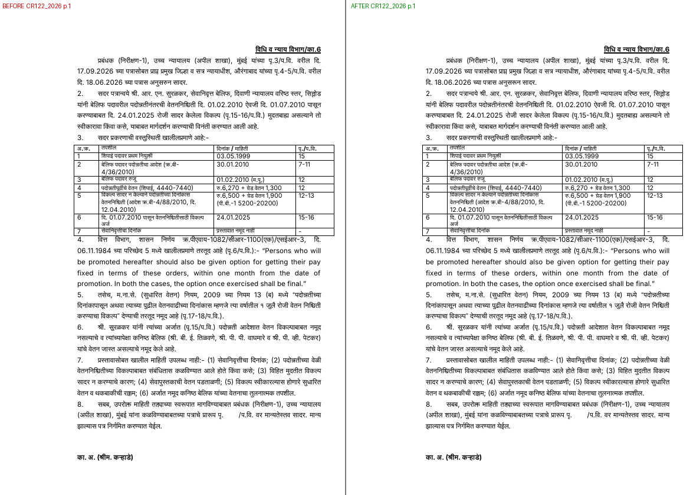
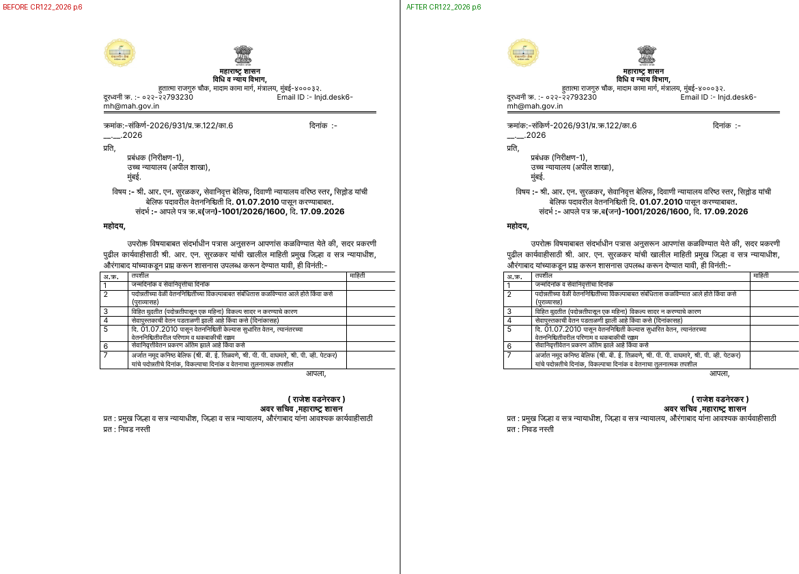
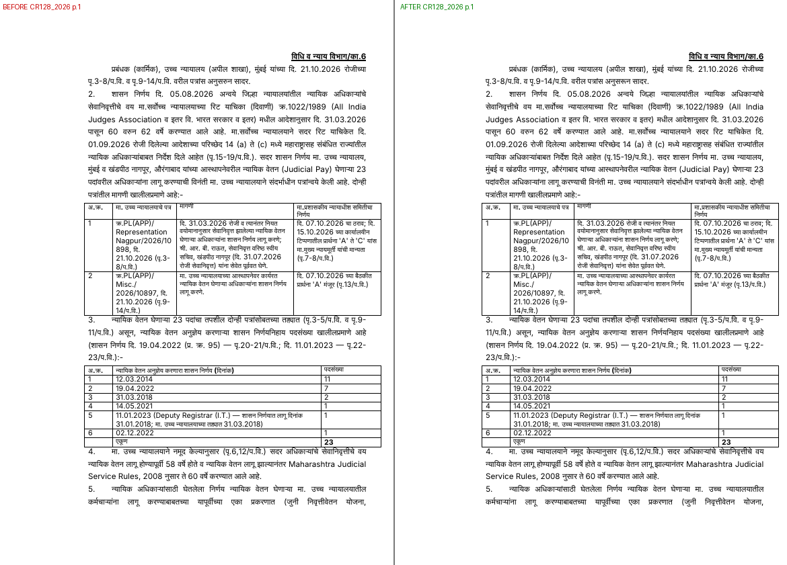
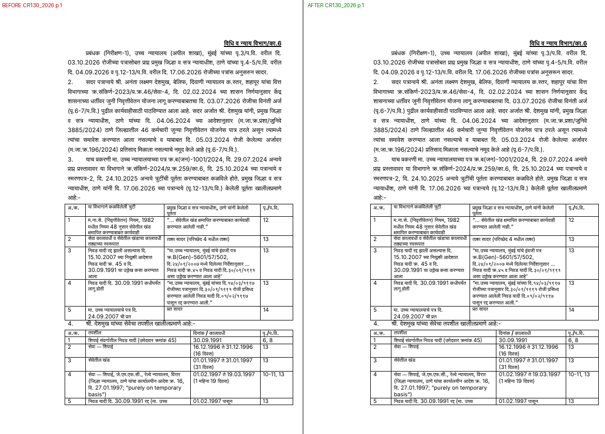
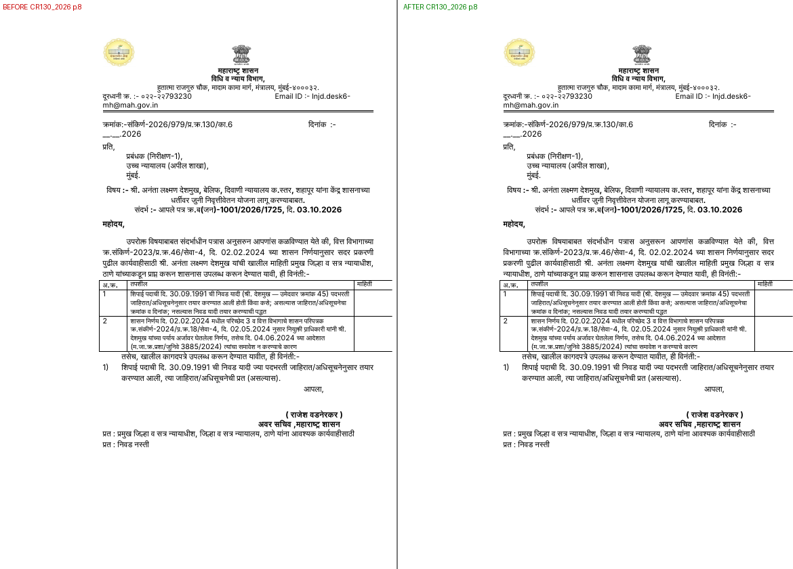
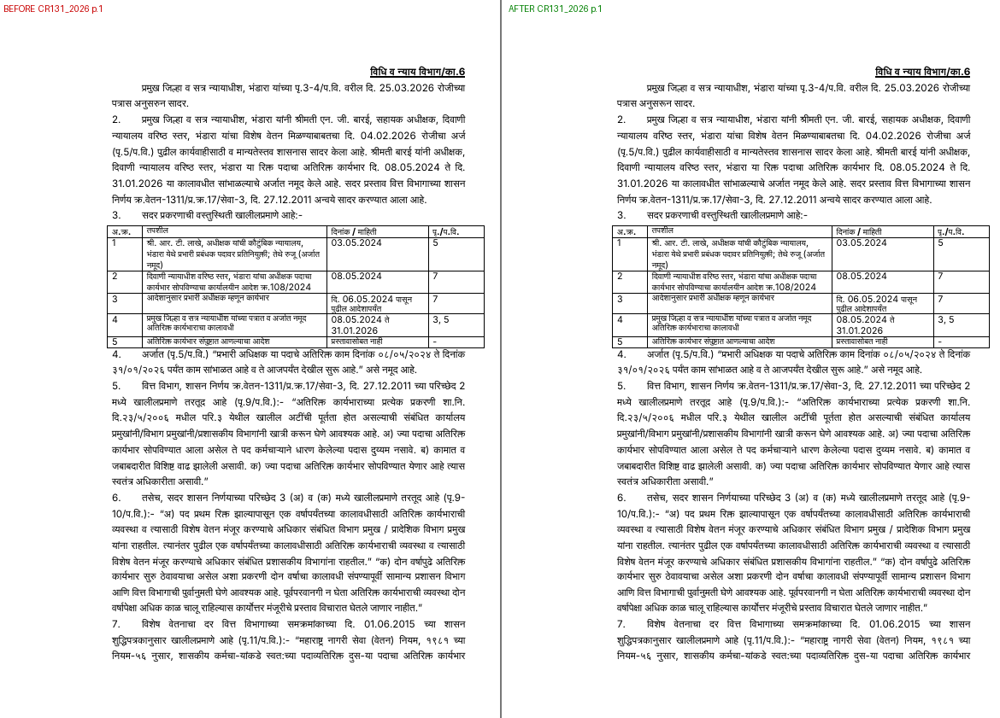
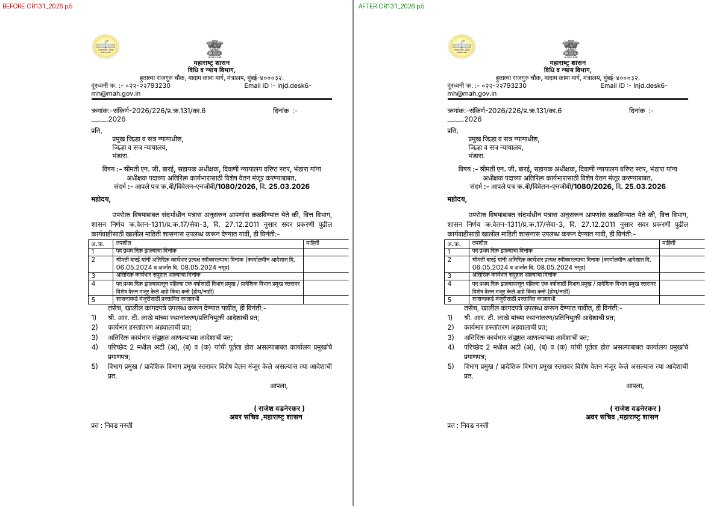
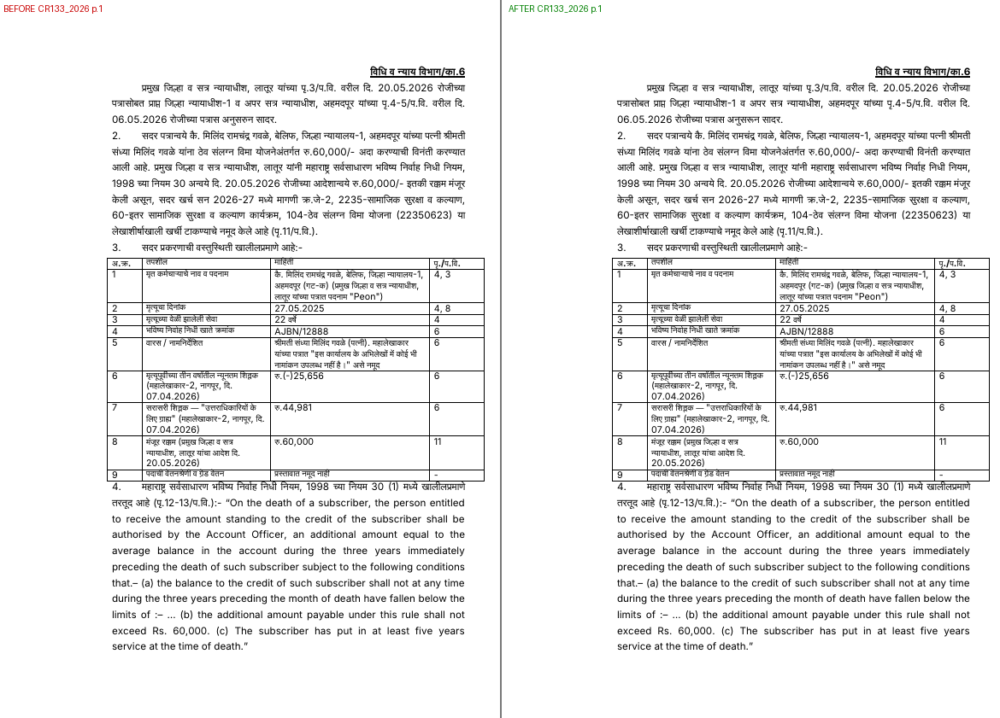
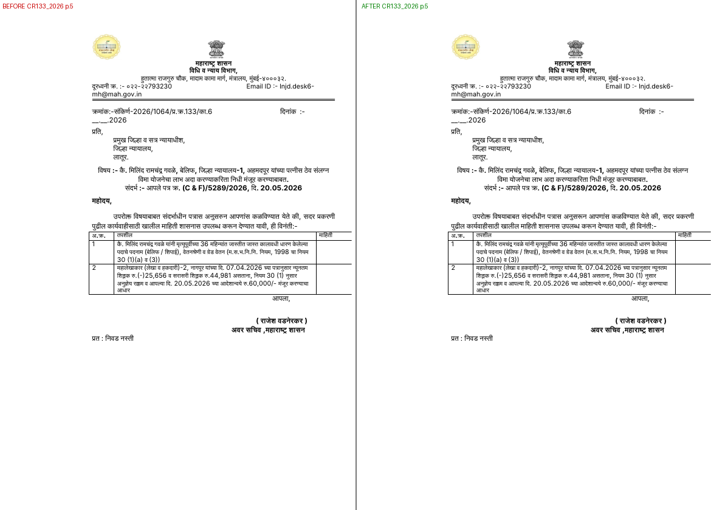
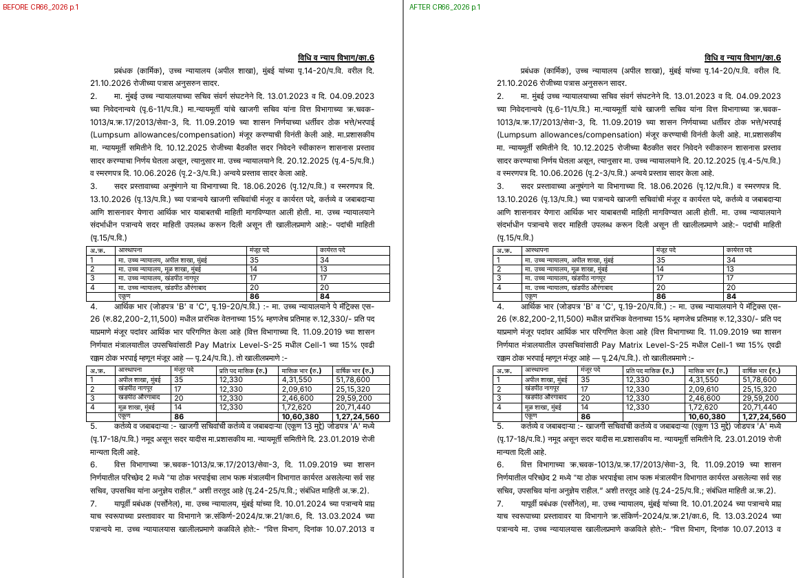

# LANG_RULES_EVIDENCE — भाषा-नियम बदलांचा पुरावा (before / after) — 02.11.2026

## उद्देश / Purpose
- मराठी: नवीन भाषा-नियम (INSTRUCTIONS §4.19 — उदा. "अनुसरुन" → "अनुसरून") मंजूर नमुन्यांवर (`samples/specs/*.json`) लागू केल्यानंतर नोंद व पत्रात नेमके काय बदलले, ते पानांच्या प्रतिमांसह (आधी | नंतर) दाखवणे. “…” मधील उतारे व "संबंधित माहिती (संदर्भासाठी)" मधील GR-उतारे बदललेले नाहीत, याची स्वयंचलित तपासणी.
- English: show, with page images (before | after) and a text table, exactly what changed in the approved sample notes/letters when the new language rules are applied; prove automatically that no verbatim quote (“…”) and no "संबंधित माहिती" extract changed (OWNER_RULES A.12: charts/screenshots, not numbers alone).

## कसे तयार केले / How it is produced
```
# BEFORE = samples at HEAD (built with --no-lint: the new §4.19 lint already rejects 'अनुसरुन', and the BEFORE state must still be built as it is)
python3 tools/lang_evidence.py build <scratch>/before --no-lint
# AFTER = samples after the spec change (normal lint must pass)
python3 tools/lang_evidence.py build <scratch>/after
# diff table + quote/related guard + side-by-side images of changed pages only
python3 tools/lang_evidence.py compare <scratch>/before <scratch>/after --img docs/lang-evidence --md <scratch>/diff.md
```
- `build`: `tools/build_note_letter.py` → `<PREFIX>_Note_and_Letter.docx` + LibreOffice PDF preview → every page as PNG at 70 dpi (`pdftoppm`) + `<PREFIX>.txt` (docx text in body order; table cells as `[T r c]` lines).
- `compare`: (b) paragraph-by-paragraph diff → table below (changed words in **bold**); (c) `<PREFIX>_pNN_sbs.png` (BEFORE | AFTER) only for pages whose image changed; (d) guard — prints `OK`/`FAIL` per sample; exit 1 on any FAIL.
- Self-test 02.11.2026: BEFORE vs BEFORE → no differences, all six guards OK. Synthetic test (CR131 with 'अनुसरून' in a scratch copy) → 2 rows (note ¶ para 1, letter intro), 2 changed pages; a tampered quote → guard FAIL.
- Fonts: the previews are rendered by LibreOffice without DVOT-SurekhMR in the container (fallback font); the docx files carry DVOT-SurekhMR on every run (build check "bad-font runs: 0").

## Verbatim spans that must NOT change (found in BEFORE)
| sample | spec field | 'अनुसरुन' outside quotes (to change) | inside quotes / related extract (keep) |
|---|---|---|---|
| CR122_2026 | note.first, letter.intro / related[3].text[2] | 2 | 1 |
| CR128_2026 | note.first / related[6].text[0] | 1 | 1 |
| CR130_2026 | note.first, letter.intro | 2 | 0 |
| CR131_2026 | note.first, letter.intro | 2 | 0 |
| CR133_2026 | note.first, letter.intro | 2 | 0 |
| CR66_2026 | note.first | 1 | 0 |

Expected changed preview pages (BEFORE, LibreOffice): CR122 p.1, 6 · CR128 p.1 · CR130 p.1, 8 · CR131 p.1, 5 · CR133 p.1, 5 · CR66 p.1 (CR122 p.5 and CR128 p.6 carry the word only inside related extracts — must stay unchanged).

## verify_outputs.py on the samples — what is real, what is a stand-in
The samples' real proposal PDFs and packages are confidential and not in the repo, so Step 7 is run with:
| input | status |
|---|---|
| `<PREFIX>_Note_and_Letter.docx` | REAL — built from `samples/specs/*.json` |
| package PDF | STAND-IN — `tools/pkg3.py` on a blank proposal of N pages, N = highest "पृ.N/प.वि." / "पॅकेज PDF पृ. N" cited in the built docx; no enclosures; file name `<PREFIX>_standin_proposal.pdf` |
| `<proposal pages>` argument | STAND-IN = N |
| `<PREFIX>_Study.docx` | STAND-IN — `tools/build_study.py` from a stub with headings भाग 0 … भाग 7 |
So the Note/Letter checks (fonts, ids, repo paths, page refs ≤ N, banned words, §4.18, §4.19, §4.23, signers, Finance, letter format) are real; the package and Study checks only prove the harness works.

### BEFORE results (02.11.2026, HEAD samples, current lint/verify)
| sample | N | result | failing check |
|---|---|---|---|
| CR122_2026 | 40 | 24 OK, 1 FAIL | §4.19: note + letter 'अनुसरुन' |
| CR128_2026 | 31 | 24 OK, 1 FAIL | §4.19: note 'अनुसरुन' |
| CR130_2026 | 20 | 24 OK, 1 FAIL | §4.19: note + letter 'अनुसरुन' |
| CR131_2026 | 13 | 24 OK, 1 FAIL | §4.19: note + letter 'अनुसरुन' |
| CR133_2026 | 13 | 24 OK, 1 FAIL | §4.19: note + letter 'अनुसरुन' |
| CR66_2026 | 25 | 20 OK, 1 FAIL (no letter: letter checks not applicable) | §4.19: note 'अनुसरुन' |

### AFTER results (02.11.2026, samples after the spec change; new lint/verify incl. L11–L14 warnings)
| sample | N | result | WARN lines |
|---|---|---|---|
| CR122_2026 | 40 | ALL OK | 0 |
| CR128_2026 | 31 | ALL OK | 0 |
| CR130_2026 | 20 | ALL OK | 0 |
| CR131_2026 | 13 | ALL OK | 0 |
| CR133_2026 | 13 | ALL OK | 0 |
| CR66_2026 | 25 | ALL OK | 0 |
Guard (compare): every sample `OK` — quoted spans and संबंधित माहिती lines unchanged (CR122: 11 quotes/29 lines,
CR128: 4/43, CR130: 19/44, CR131: 7/23, CR133: 6/23, CR66: 4/15). `tools/lint_spec.py`: LINT OK, 0 WARN for all six.
Rule/source for every change below: "अनुसरुन" → "अनुसरून" — शुद्धलेखन नियम 8 (verb form -ऊन; GAD "टिप्पणी लेखन व
पत्रव्यवहार" परिशिष्ट 1 / STYLE_RESEARCH_LANG §5.2), INSTRUCTIONS §4.19/§4.25.

## Before / after text table (10 changes in 6 samples; nothing else changed)
| sample | location | before | after |
|---|---|---|---|
| CR122_2026 | note ¶2 | … पृ.4-5/प.वि. वरील दि. 18.06.2026 च्या पत्रास **अनुसरुन** सादर. | … पृ.4-5/प.वि. वरील दि. 18.06.2026 च्या पत्रास **अनुसरून** सादर. |
| CR122_2026 | letter ¶16 | … उपरोक्त विषयाबाबत संदर्भाधीन पत्रास **अनुसरुन** आपणांस कळविण्यात येते की, सदर प्रकरणी … | … उपरोक्त विषयाबाबत संदर्भाधीन पत्रास **अनुसरून** आपणांस कळविण्यात येते की, सदर प्रकरणी … |
| CR128_2026 | note ¶2 | … रोजीच्या पृ.3-8/प.वि. व पृ.9-14/प.वि. वरील पत्रांस **अनुसरुन** सादर. | … रोजीच्या पृ.3-8/प.वि. व पृ.9-14/प.वि. वरील पत्रांस **अनुसरून** सादर. |
| CR130_2026 | note ¶2 | … पृ.12-13/प.वि. वरील दि. 17.06.2026 रोजीच्या पत्रांस **अनुसरुन** सादर. | … पृ.12-13/प.वि. वरील दि. 17.06.2026 रोजीच्या पत्रांस **अनुसरून** सादर. |
| CR130_2026 | letter ¶16 | … उपरोक्त विषयाबाबत संदर्भाधीन पत्रास **अनुसरुन** आपणांस कळविण्यात येते की, वित्त विभागाच्या … | … उपरोक्त विषयाबाबत संदर्भाधीन पत्रास **अनुसरून** आपणांस कळविण्यात येते की, वित्त विभागाच्या … |
| CR131_2026 | note ¶2 | … पृ.3-4/प.वि. वरील दि. 25.03.2026 रोजीच्या पत्रास **अनुसरुन** सादर. | … पृ.3-4/प.वि. वरील दि. 25.03.2026 रोजीच्या पत्रास **अनुसरून** सादर. |
| CR131_2026 | letter ¶16 | … उपरोक्त विषयाबाबत संदर्भाधीन पत्रास **अनुसरुन** आपणांस कळविण्यात येते की, वित्त विभाग, … | … उपरोक्त विषयाबाबत संदर्भाधीन पत्रास **अनुसरून** आपणांस कळविण्यात येते की, वित्त विभाग, … |
| CR133_2026 | note ¶2 | … पृ.4-5/प.वि. वरील दि. 06.05.2026 रोजीच्या पत्रास **अनुसरुन** सादर. | … पृ.4-5/प.वि. वरील दि. 06.05.2026 रोजीच्या पत्रास **अनुसरून** सादर. |
| CR133_2026 | letter ¶16 | … उपरोक्त विषयाबाबत संदर्भाधीन पत्रास **अनुसरुन** आपणांस कळविण्यात येते की, सदर प्रकरणी … | … उपरोक्त विषयाबाबत संदर्भाधीन पत्रास **अनुसरून** आपणांस कळविण्यात येते की, सदर प्रकरणी … |
| CR66_2026 | note ¶2 | … पृ.14-20/प.वि. वरील दि. 21.10.2026 रोजीच्या पत्रास **अनुसरुन** सादर. | … पृ.14-20/प.वि. वरील दि. 21.10.2026 रोजीच्या पत्रास **अनुसरून** सादर. |

## Page images (BEFORE | AFTER, changed pages only, 70 dpi; total 1.5 MB)
- CR122_2026 p.1: 
- CR122_2026 p.6: 
- CR128_2026 p.1: 
- CR130_2026 p.1: 
- CR130_2026 p.8: 
- CR131_2026 p.1: 
- CR131_2026 p.5: 
- CR133_2026 p.1: 
- CR133_2026 p.5: 
- CR66_2026 p.1: 
